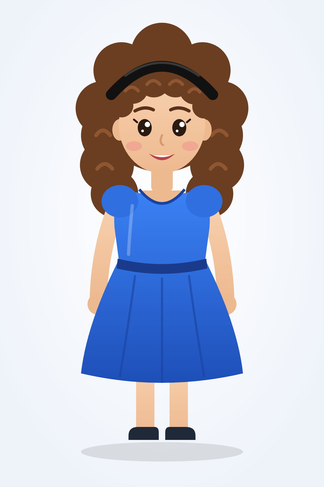

# María

Personaje para los vídeos.

## Características

- **Vestido:** azul (degradado #3B82F6 → #1E4FB8), mangas abullonadas, escote redondo,
  cinturón azul marino (#1A3A8C) y falda acampanada por encima de la rodilla con pliegues.
- **Pelo:** castaño (#6B3E22, reflejos #8E5631), muy rizado, con volumen moderado,
  largo justo por encima de los hombros, flequillo de rizos.
- **Diadema:** negra (#111111).
- **Complexión:** ni muy delgada ni rellena; algo más ancha que Marta.
- **Cara:** ojos grandes marrón oscuro con brillos, pestañas, mejillas sonrosadas, sonrisa.
- **Piel:** clara cálida (#F8D2B0 → #EDB98F).
- **Zapatos:** oscuros (#1F2937).
- **Estilo:** plano tipo dibujo animado, con degradados suaves.

## Archivos

- `maria.svg`: vector editable (original)
- `maria.png`: imagen 1200×1800
