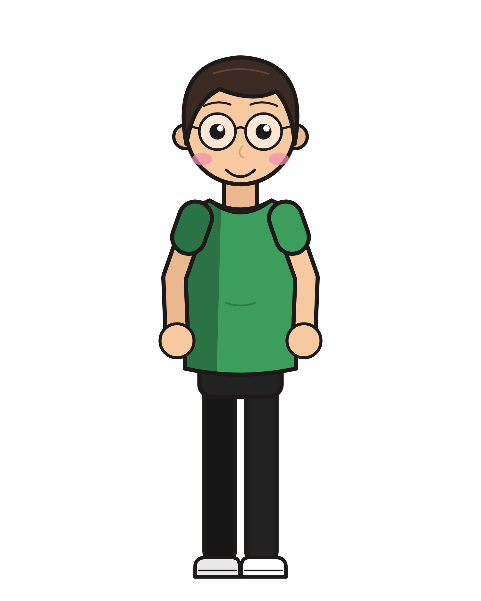

# Pedro (de frente)

Personaje fijo para los próximos vídeos. Es la versión mejorada del Pedro del vídeo 05 y del cartel:
ahora está **de frente**, igual que María, con **cuello** y **brazos con codo**.



## Características

- **Gafas:** redondas, montura negra fina, cristales claros con brillo.
- **Pelo:** corto, castaño muy oscuro (#3B2A24), flequillo de lado, con volumen arriba.
- **Camiseta:** verde (#3C9D5D, sombra #2A7344), manga corta, cuello redondo.
- **Pantalón:** negro (#222222). **Zapatillas:** blancas.
- **Piel:** #F6C9A0 (sombra #E9B88F), mejillas rosadas.
- **Estilo:** el de la serie, con contorno negro de grosor constante, colores planos y sombra dura a la izquierda.
- **Expresiones:** `happy`, `normal`, `grin`, `laugh`, `sparkle`, `wink`, `surprise` y `tired`. También `talk` (boca que habla), `blink` y `look`.

## Uso en los vídeos

`pedro.js` usa el mismo sistema que `src/maria.js`: suelo en y=204, centro x=190 y altura ≈ 144.
Necesita `lib.js` y, para las manos, `hand11` de `v11.js`.

```js
placePedroF(px, pies, escala, {
  expr: 'grin', talk: 0.5,
  armF: { h: [229.5, 93], side: -1, hand: 'point', dir: -28 },  // brazo a la derecha de la imagen
  armB: PD_REST_B
});
```

Para usarlo en un vídeo, copia `pedro.js` a `src/` y cárgalo en `src/index.html` después de `maria.js` y `v11.js`.

## Archivos

- `pedro.js`: código del personaje (fuente).
- `pedro.png`: referencia de 1500×1875 con fondo transparente.
